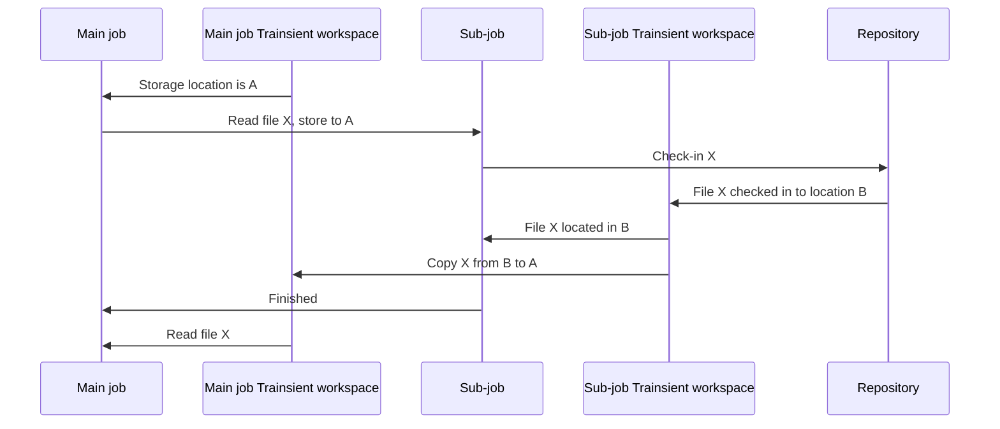

# The problem
Normally, a repository job in LSAF is allowed to access the repository files it checked out as parameters. It is often sufficient, but sometimes becomes a major chore.

Imagine, for example, that one has to scan a big folder in LSAF repository, find some files there and read them. Checking out the whole folder might amount to tens of Gb of transient workspace storage. It is a huge waste of IOPS, and a few such jobs running simultaneously can easily exhaust transient storage.
# A solution
I came up with somewhat elegant solution by checking in a file via a sub-job executed by the main job, with this sub-job copying the file to the main job's transient workspace.

LSAF allows this because the sub-job inherits Unix userid of the main job, and transient workspace is just a folder on mapped drive. While both jobs are running, it is completely a legitimate operation to 
# Is it a good thing to do?
I think so, provided it is explicitly documented in technical specifications.

A purist might argue that this approach tries to circumvent the data traceability in job manifest files. I think that the full record of read files is in the sub-job run manifests, and also in the main job logs.

Unfortunately, there is no LSAF API macro to programmatically check out a file to transient workspace. Both `%lsaf_checkin()` and `%lsaf_copy()` store the file in user's workspace _even if called from a repository job_. 
# What the alternatives are?
There are not much other ways to read files programmatically. I suppose that workflows can be the official solution. I never got these working, as the Eclipse plug-in they depend on no longer works.

Another thing I never tested is using LSAF REST API via `PROC HTTP` to read the repository files directly. I am not sure (TODO check it) if LSAF supports borrowing a bearer token via `sas_services` as Viya does; I would be surprised if LSAF does it, given how haphazardly LSAF REST API is designed compared to Viya.